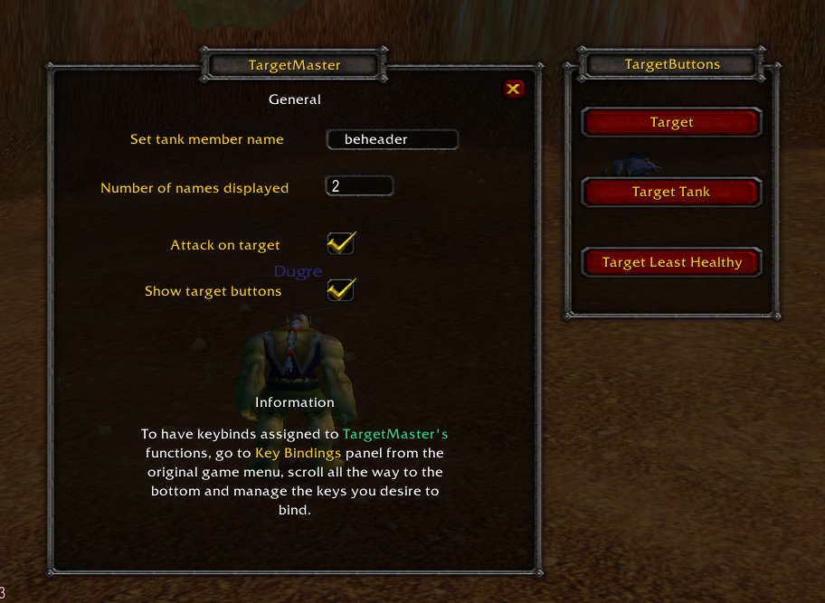
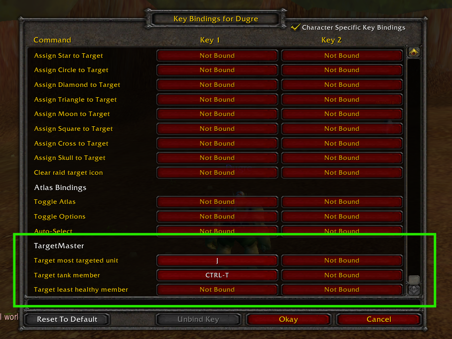
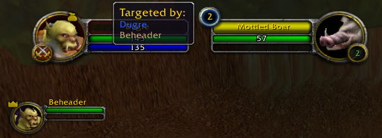
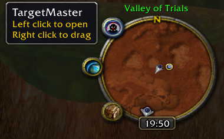

# TargetMaster 1.12.1

**Target helper for party groups or raids.**

## Features

In the middle of a fight or crowded situation, targeting the most targeted creature can be a hassle. **TargetMaster's** main job is to make your character target the most targeted creature in the fight in one keystroke.

**TargetMaster** also provides visual feedback for how many members, including you, of your party/raid are targeting the current creature. It is shown by a round button by the left side of targeted unit portrait frame and if you hover on top of it, it shows you the name of the members targeting it.

The **attack on target** function of this addon offers the convenience of automatically attacking the most targeted unit without toggling between canceling the attack action back and forth if your character was already attacking previously. This makes you able to spam the most targeted function as much as you'd like to attack the desired creature.

The function that **targets the tank** is pretty straightforward. Provide the tank member's name in the first input box of the main menu frame and TargetMaster will do the rest. You can also assign this function to any member for whatever reason whatsoever, the tank label is just for the general purpose of the function.

## Screenshots

### Main panels

### Keybinds

### Count frame for target portraits

### Minimap icon
